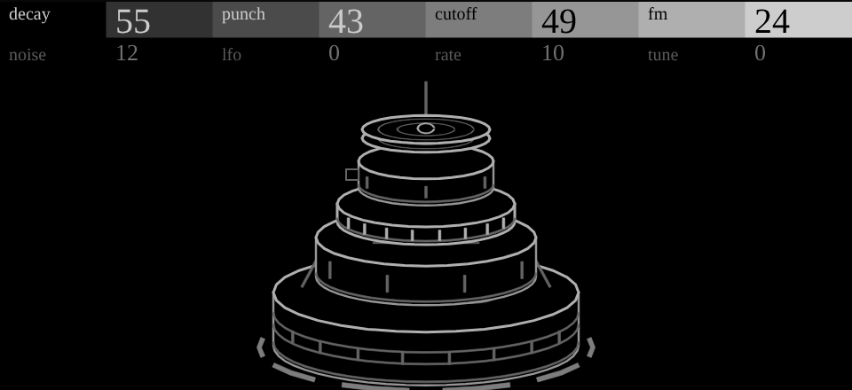

# theseus

A DFAM-style percussion voice: one voice, and the note picks the drum. Low notes are kicks (a sine with a deep
pitch drop), the middle toms and snare, high notes lean on noise and FM into hats and metal. It's my OP-1 plugin
ported to the OP-XY with its integer DSP kept, plus a Tune control the OP-1 version didn't have.



## Controls

Press any encoder to switch pages. Set the track's envelope to a fast attack and full sustain, so theseus's own
decay shapes each hit.

| Page | Control | What it does | On screen |
| --- | --- | --- | --- |
| 1 | Decay | 30 ms to 1.5 s, high drums shorter | rings spread across the struck head |
| 1 | Punch | Pitch-envelope depth, up to ×7 | how high the struck drum jumps; how far the hats rock |
| 1 | Cutoff | Low-pass, opened further by the hit | how brightly the struck head fills |
| 1 | FM | VCO 1 into VCO 2, and VCO 2's level | ghost hoops thrown off the struck head |
| 2 | Noise | Noise on top of what the upper zones bring | sparks off the struck head |
| 2 | LFO | Depth of the hit LFO on cutoff, FM and a little pitch | some hits jump higher than others |
| 2 | Rate | Hit LFO speed: one cycle every 32 .. 2 hits | the floor clock: one dash per hit of the cycle |
| 2 | Tune | Shifts which drum a note picks, -24 .. +24 semitones | which tier the hits land on |

**The hit LFO** steps once per note rather than with a clock, so it's locked to the sequence: at Rate 2 it
alternates every other hit, at 32 it drifts across two bars of sixteenths.

**Tune** moves which drum a note picks without changing the note. The XY's sequencer plays fixed pitches, so this
moves a whole pattern from toms to hats, and a parameter lock on one step picks a different drum for just that step.

## Screen

The kit stacked into a tower, kick to hi-hat, in line drawing. Only the drum that's hit moves, only upward, and
only its head fills. The screen gets no pitch, so the drum it lights comes from a 16-step stand-in groove shifted
by Tune the way the engine shifts a pitch's zone. 232 nodes and one mutable path (the floor clock's lit slice).
The artwork sits close to the SDK preview's 64 KiB limit on `panel.svg`, which is why the path data is compact and
FM's hoops are one shared set. The design is in operator-design's `screens/theseus/` and its library.

## Checks

```sh
python ../open-xy/sdk.py test --machine machines/theseus
```

`tests/sound.cpp` sweeps every control and pad: every hit audible and decaying, no clipping, kick longer and darker
than hat, Punch sweeps pitch, Cutoff, FM and Noise change brightness, the LFO steps at the set rate, and Tune moves
the zones.

Device: pending. No hardware CPU record yet; it's the one to measure first, since its heaviest setting sits near
the SDK's aim on the host estimate.
