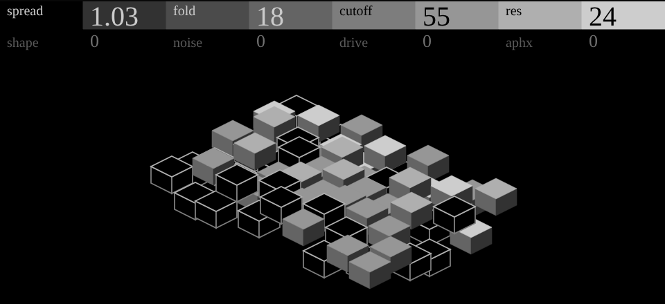

# toro

A two-oscillator voice with a wavefolder, a resonant low-pass and APHX, a drift that turns to chaos. It's my OP-1
plugin of the same name, ported to the OP-XY with its integer DSP kept as it was, plus two things the XY version
adds: a split Aphx and a hit-stepped accent.



## Controls

Press any encoder to switch pages.

| Page | Control | What it does | On screen |
| --- | --- | --- | --- |
| 1 | Spread | Oscillator 2 at 1.0 to 1.5 times oscillator 1 | a second, slower wave beats across the field |
| 1 | Fold | Wavefolder gain, 1× to 8× | heights fold back on themselves; the field wraps round a drum |
| 1 | Cutoff | Low-pass, squared response | a fine ripple of harmonics on top of the two waves |
| 1 | Res | Low-pass resonance | one row of tops lights, front to back |
| 2 | Shape | Saw to triangle, both oscillators | ridges go from a sharp leading edge to symmetric |
| 2 | Noise | Noise into the folder | jitter in every column |
| 2 | Drive | Output soft clip, 1× to 4× | the tallest columns flatten |
| 2 | Aphx | Bipolar, centre off: right is per-key drift, left re-rolls on every note | columns wander: fixed per spot on the right, fresh per note on the left |

**Aphx.** Right of centre every key keeps its own offsets to tuning, cutoff, fold, shape and resonance, growing to
the right; the top fifth adds a per-key sample-and-hold crush. Left of centre is the same drift, growing to the
left, but each note takes its offsets from the track's note count instead of its key. Lock a single sequencer step
to the left side and just that step re-rolls; the same pattern still plays back the same way.

**Accent.** The XY gives engines no velocity, so toro steps its own accent once per note, locked to the sequence:
strong, weak, medium, weak. An accent deepens Aphx on that note (by half when strong, a quarter when medium), so
it's silent with Aphx at centre.

Presets: Clean, Bull, Drift, Labyrinth, and Roll for the per-step side.

## Screen

A field of 70 stacked isometric slabs whose heights are a small model of the voice. A note rolls the wave forward
a step, pushes a patch of six slabs up with white tops and sends a ripple out; it settles in under a second, and
the idle field doesn't move. 218 nodes, no mutable paths, 10 palette entries. `gen_panel.py` writes the artwork
and the per-column tables in `nodes.h`; `display.cpp` is integer-only. The design is in operator-design's
`screens/toro/`.

## Checks

```sh
python ../open-xy/sdk.py test --machine machines/toro
```

`tests/sound.cpp` sweeps every control at low and high notes for the declared peak, checks DC, that Cutoff and
Fold change brightness, that per-key Aphx is repeatable and gentle at a quarter, that centre is off, that the left
side re-rolls per note and repeats per count, and that strong notes drift further.

Device: pending. No hardware CPU record yet.
